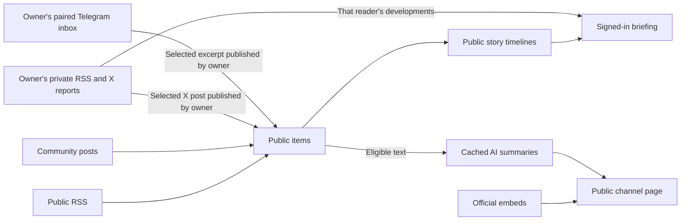

# NewsDrop architecture

NewsDrop helps readers follow market-moving news across Energy, Tech, Healthcare, Industrials, Consumer Discretionary, Materials, Utilities and Real Estate. A reader can find a channel, inspect a report and its sources, discuss it, and follow the next development in that story. General News accommodates multi-topic publishers and reports outside the eight sectors.

## What readers see

| View | What it answers |
| --- | --- |
| Home | What changed since my last visit? Signed-in readers see a briefing with dated developments, citations and the reason each story appeared. The sector directory is available to everyone. |
| Discover | Which channels cover this subject? Readers can filter by sector, sort by name, category or clicks, browse new channels or see which ones have attracted clicks. |
| Following | What are my sources reporting? A reader's subscriptions and enabled private sources share one feed. Saved sector filters narrow that feed. Channel notifications are independently configurable. |
| My Sources | Which sources do I own or want to publish? Readers manage their private connections, create public channels and choose individual eligible messages or posts to share. |
| Channel and story pages | Who reported this, and what changed? Channels have an attributed description, recommendations, reports and discussion. Story timelines preserve dated source material and substantive updates. |

## How a public report reaches a reader

1. RSS channels sharing a public feed URL share collection. The worker polls with HTTP validators and backoff. Community posts enter through the publishing API. The bundled X channels include dated editorial selections. Configured operator X adapters add new posts to the matching editorial channel by stable platform account ID. An X or Telegram embed remains a display surface. Readers can separately publish a selected authorized X post or Telegram inbox excerpt.
2. The catalog preserves the item identifier, source link, original text, byline, publication time and collection time. It recognizes repeated delivery and maintains a stable story identity through edits. Related reporting can share a timeline when an article URL, distinctive headline or a combination of named subjects and headline overlap connects the reports.
3. Articles carry a sector and text-derived labels for subsectors, events, entities and places. A reader can follow a story or combine labels into a saved topic. Each label in the combination must match the same report.
4. A background worker produces optional public AI summaries from eligible source text. RSS is the default. The cache keys include the content revision, model and prompt version. A server-side daily budget and retries bound provider usage. Source excerpts remain readable during an outage.
5. Following shows recent articles. Home groups material developments since the reader's acknowledged briefing. Reopening an unchanged report produces no new development. Private source stories use their own owner-scoped records and become visible in the reader's Home and Following views.

## Storage and visibility

The public catalog separates the feed or publisher (`news_sources`), the channel a reader subscribes to (`news_channels`), and the original report (`news_items`). Channels pointing to the same RSS URL can share collection. A timeline has its own identity in `news_stories`. Membership in `news_story_items` and the dated evidence in `news_developments` let a follow survive a headline correction.

Private items and developments retain the account owner in the `personal_*` tables. When Home reads a briefing, it combines eligible public developments with those belonging to that account. When the reader marks the briefing as read, the service acknowledges both sets of changes in one SQLite transaction. Visit positions belong to the account, so another signed-in device picks up from the saved position. [API contracts](contracts.md)

## Components

| Component | Responsibility |
| --- | --- |
| `main.jac`, `app.jac`, `auth.jac` | Start the FastAPI application, assemble workers, serve the built client and resolve users from session cookies. |
| `db/directory_seed.json`, `db/directory.jac` | Provide the initial RSS editions, social profiles and editorial directory. |
| `publicnews/catalog.py`, `publicnews/schema.sql` | Store public sources, channels, normalized items, subscriptions, recommendations, discussions and alerts. |
| `publicnews/worker.py`, `publicnews/providers.py` | Refresh shared RSS feeds and generate revision-cached summaries using server-side provider settings. |
| `publicnews/briefing.py`, `publicnews/topics.py`, `publicnews/storytext.py` | Maintain story membership, dated developments, watch labels and per-reader visit checkpoints. The source-text change rules also serve private stories. |
| `personal/` | Keep private connections, collection, notifications and story timelines scoped to their owner. Publishing copies only the selected material into a matching public channel. |
| `web/` | Jac web client for the briefing, directory, Following, My Sources, discussions and watch controls. |
| `adapters/`, `pipeline/`, `db/repo.jac` | Process configured market-monitoring accounts, classify and cluster posts, and produce event notifications, quotes and trade suggestions for the supported instruments. The operator portfolio is manually maintained. |
| `desktop/`, `mobile/` | The Tauri window starts or reuses a local service, or opens a shared server with `NEWSBOT_URL`. The Expo client consumes market-event notifications. The installable web app opens My Sources and delivers opt-in personal Web Push. [PWA guide](pwa.md) · [Hosted desktop demo](demo-hosting.md) |

## Running the service

Run a single FastAPI worker with persistent SQLite storage. Browsers and devices pointed at the same server share the public catalog and use their own account sessions. The desktop wrapper starts or reuses a local service. Publishing from a local database reaches clients of that service. A shared demo uses a common HTTPS address and durable storage.

Provider credentials and model configuration belong on the server. Public RSS requires no reader key. Personal X connections use an authorized provider and a configured server-side encryption key. The Telegram inbox requires a configured bot. Content from private connections stays owner-scoped until the reader confirms a publication.

The offline verification command is `python3 scripts/check.py` (`python scripts/check.py` on native Windows). It runs helper tests, Jac formatting and type checks, application tests and the web build using replay data.

See [getting started](getting-started.md), the [product specification](spec.md), [reader guide](feature-overhaul.md), [personal source guide](personal-sources.md) and [service contracts](contracts.md).
